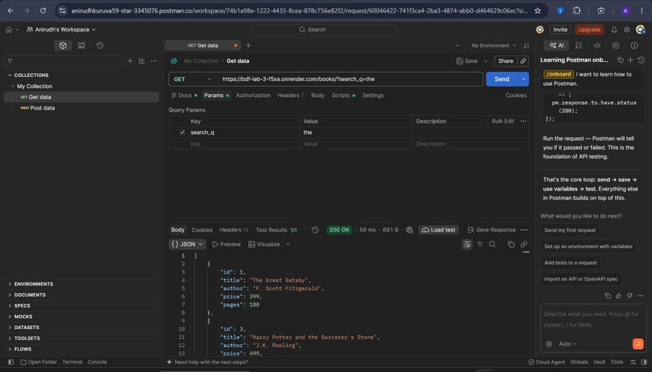
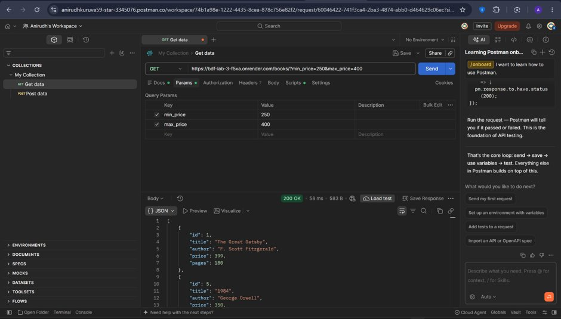
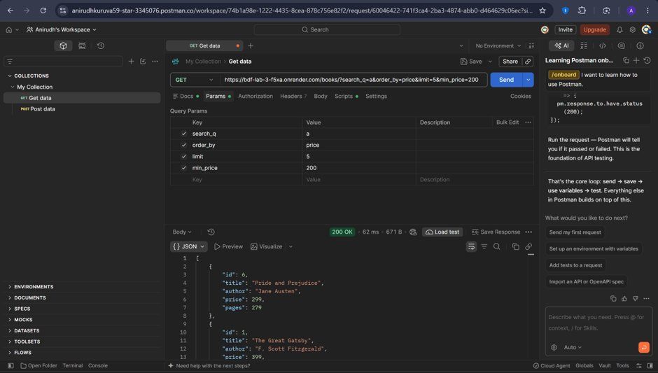

# BDF Lab 3 — REST API, Query Parameters, Validation, and Debugging

A production-grade RESTful API service built with **Node.js**, **Express.js**, and **SQLite**. This project implements complete CRUD operations, flexible query parameters (filtering, search, sorting, pagination), rigorous input validation, standardized HTTP status codes, structured JSON responses, and comprehensive debugging solutions.

---

## 1. Student Information

| Field | Details |
| :--- | :--- |
| **Student Name** | KURUVA ANIRUDH |
| **Registration Number** | 252U1R9082 |
| **Class / Section** | CSE-GEN_A.I-2B |
| **Institution** | Aurora Higher Education and Research Academy |
| **Course** | Backend Development Frameworks (BDF) |
| **Lab Exercise** | Lab 3: REST API, Query Parameters, Validation, and Debugging |

---

## 2. Project Overview

The **BDF Lab 3 Books API** is a modular RESTful backend that provides complete catalog management for books. Designed following clean architecture principles, it offers:
- Full **CRUD** (Create, Read, Update, Delete) resource lifecycle management.
- Dynamic **Query Parameters** for title pattern matching, column-based sorting, pagination with limit/offset, and numerical range filtering.
- Multi-layered **Input Validation** rejecting malformed payloads, non-numeric prices, negative counts, and invalid parameters with HTTP `400 Bad Request`.
- Promise-based, non-blocking asynchronous **SQLite** interactions using parameterized statements to eliminate SQL injection.
- Production-readiness for cloud deployment on platforms such as **Render**.

---

## 3. Objectives

1. Design and establish a relational schema in SQLite with automated idempotent seeding.
2. Build standardized REST endpoints mapped to appropriate HTTP verbs (`GET`, `POST`, `PUT`, `DELETE`).
3. Implement advanced query handling for partial text searching (`LIKE`), sorting (`ORDER BY`), pagination (`LIMIT`/`OFFSET`), and range filters (`BETWEEN`).
4. Enforce strict server-side validation with clean JSON error responses.
5. Apply asynchronous programming best practices (`async`/`await` and Promise wrappers).
6. Document and resolve four real-world Node.js/Express backend debugging exercises.
7. Execute an automated test suite (`test_runner.js`) and perform manual Postman test case verification.

---

## 4. Technology Stack

- **Runtime Environment:** Node.js (v18+)
- **Web Framework:** Express.js (v4.19+)
- **Database Engine:** SQLite3 (v5.1+)
- **Language:** JavaScript (ES6+ / CommonJS)
- **API Testing:** Postman & Native Node.js Test Suite (`test_runner.js`)
- **Version Control:** Git & GitHub
- **Deployment Platform:** Render

---

## 5. Project Folder Structure

```text
BDF_Lab_03/
│
├── index.js              # Express application, routes, SQLite connection & validation
├── package.json          # Node dependencies, scripts, and metadata
├── package-lock.json     # Locked dependency tree
├── books.db              # SQLite database (auto-generated & seeded on startup)
├── README.md             # Comprehensive technical documentation
├── test_runner.js        # Automated end-to-end API test runner (20 test cases)
├── .gitignore            # Excludes node_modules, .env, and OS artifacts
└── screenshots/          # Postman verification evidence screenshots
    ├── 01_get_all_books.png
    ├── 02_get_book_by_id.png
    ├── 03_search_harry.png
    ├── 04_sort_price_asc.png
    ├── 05_sort_price_desc.png
    ├── 06_pagination.png
    ├── 07_price_filter.png
    ├── 08_combined_query.png
    ├── 09_post_create.png
    ├── 10_put_update.png
    ├── 11_delete.png
    ├── 12_missing_title.png
    ├── 13_non_numeric_price.png
    ├── 14_not_found_404.png
    └── 15_invalid_order_by.png
```

---

## 6. Database Schema

The database file `books.db` contains a single table named `book`:

```sql
CREATE TABLE IF NOT EXISTS book (
  id INTEGER PRIMARY KEY AUTOINCREMENT,
  title TEXT NOT NULL,
  author TEXT NOT NULL,
  price REAL NOT NULL,
  pages INTEGER NOT NULL
);
```

### Column Specifications

| Column Name | Data Type | Constraints | Description |
| :--- | :--- | :--- | :--- |
| `id` | `INTEGER` | `PRIMARY KEY AUTOINCREMENT` | Unique identifier for each book record. |
| `title` | `TEXT` | `NOT NULL` | The title of the book. |
| `author` | `TEXT` | `NOT NULL` | The full name of the author. |
| `price` | `REAL` | `NOT NULL` | Retail price in INR (must be $\ge 0$). |
| `pages` | `INTEGER` | `NOT NULL` | Number of printed pages (must be $> 0$). |

---

## 7. Sample Database Records

On initial server startup, the database checks `SELECT COUNT(*) AS count FROM book`. If the count is `0`, it automatically seeds the following 10 records without duplicating on restarts:

| ID | Title | Author | Price (₹) | Pages |
| :---: | :--- | :--- | :---: | :---: |
| 1 | The Great Gatsby | F. Scott Fitzgerald | 399 | 180 |
| 2 | To Kill a Mockingbird | Harper Lee | 450 | 281 |
| 3 | Harry Potter and the Sorcerer's Stone | J.K. Rowling | 499 | 309 |
| 4 | Harry Potter and the Chamber of Secrets | J.K. Rowling | 550 | 341 |
| 5 | 1984 | George Orwell | 350 | 328 |
| 6 | Pride and Prejudice | Jane Austen | 299 | 279 |
| 7 | The Catcher in the Rye | J.D. Salinger | 420 | 214 |
| 8 | The Hobbit | J.R.R. Tolkien | 620 | 310 |
| 9 | Atomic Habits | James Clear | 599 | 320 |
| 10 | Deep Work | Cal Newport | 480 | 296 |

---

## 8. REST API Endpoints

| HTTP Method | Endpoint | Description | Status Codes |
| :--- | :--- | :--- | :--- |
| `GET` | `/` | API status and endpoint directory. | `200 OK` |
| `GET` | `/books` | Retrieve books with optional search, sorting, pagination, and filtering. | `200 OK`, `400 Bad Request` |
| `GET` | `/books/:bookId` | Retrieve a single book by ID. | `200 OK`, `400 Bad Request`, `404 Not Found` |
| `POST` | `/books` | Create and insert a new book record. | `201 Created`, `400 Bad Request` |
| `PUT` | `/books/:bookId` | Update an existing book's details. | `200 OK`, `400 Bad Request`, `404 Not Found` |
| `DELETE` | `/books/:bookId` | Delete a book record from the database. | `200 OK`, `400 Bad Request`, `404 Not Found` |

---

## 9. Query Parameter Documentation

The `GET /books` endpoint supports the following optional query parameters:

| Parameter | Type | Default | Allowed Values / Rule | Example |
| :--- | :--- | :--- | :--- | :--- |
| `search_q` | String | *(None)* | Partial case-insensitive title search via `LIKE %search_q%`. | `/books?search_q=Harry` |
| `order_by` | String | `id` | Must be one of: `id`, `title`, `author`, `price`, `pages`. | `/books?order_by=price` |
| `order` | String | `ASC` | `ASC` (ascending) or `DESC` (descending). | `/books?order=DESC` |
| `limit` | Integer | *(All)* | Positive integer ($> 0$). Controls maximum records returned. | `/books?limit=5` |
| `offset` | Integer | `0` | Non-negative integer ($\ge 0$). Skips specified records. | `/books?offset=5` |
| `min_price` | Number | *(None)* | Non-negative number. Lower price threshold. | `/books?min_price=200` |
| `max_price` | Number | *(None)* | Non-negative number. Upper price threshold (`min_price <= max_price`). | `/books?max_price=400` |

### Combined Query Example
```http
GET /books?search_q=Harry&order_by=price&order=ASC&limit=5&offset=0&min_price=300&max_price=500
```

---

## 10. Request and Response Examples

### 1. GET /books
**Request:**
```http
GET /books HTTP/1.1
Host: localhost:3000
```
**Response (200 OK):**
```json
[
  {
    "id": 1,
    "title": "The Great Gatsby",
    "author": "F. Scott Fitzgerald",
    "price": 399,
    "pages": 180
  },
  {
    "id": 2,
    "title": "To Kill a Mockingbird",
    "author": "Harper Lee",
    "price": 450,
    "pages": 281
  }
]
```

### 2. GET /books/:bookId
**Request:**
```http
GET /books/1 HTTP/1.1
Host: localhost:3000
```
**Response (200 OK):**
```json
{
  "id": 1,
  "title": "The Great Gatsby",
  "author": "F. Scott Fitzgerald",
  "price": 399,
  "pages": 180
}
```

### 3. POST /books
**Request:**
```http
POST /books HTTP/1.1
Host: localhost:3000
Content-Type: application/json

{
  "title": "Atomic Habits",
  "author": "James Clear",
  "price": 599,
  "pages": 320
}
```
**Response (201 Created):**
```json
{
  "message": "Book created successfully.",
  "bookId": 11,
  "book": {
    "id": 11,
    "title": "Atomic Habits",
    "author": "James Clear",
    "price": 599,
    "pages": 320
  }
}
```

### 4. PUT /books/:bookId
**Request:**
```http
PUT /books/11 HTTP/1.1
Host: localhost:3000
Content-Type: application/json

{
  "title": "Atomic Habits - Updated",
  "author": "James Clear",
  "price": 650,
  "pages": 350
}
```
**Response (200 OK):**
```json
{
  "message": "Book updated successfully.",
  "book": {
    "id": 11,
    "title": "Atomic Habits - Updated",
    "author": "James Clear",
    "price": 650,
    "pages": 350
  }
}
```

### 5. DELETE /books/:bookId
**Request:**
```http
DELETE /books/11 HTTP/1.1
Host: localhost:3000
```
**Response (200 OK):**
```json
{
  "message": "Book deleted successfully."
}
```

---

## 11. Validation Rules

| Field / Parameter | Validation Rule | Error Status | Error Response |
| :--- | :--- | :--- | :--- |
| `title` | Must be a non-empty string. | `400 Bad Request` | `{"message": "Title is required."}` |
| `author` | Must be a non-empty string. | `400 Bad Request` | `{"message": "Author is required."}` |
| `price` | Must be a valid non-negative number. | `400 Bad Request` | `{"message": "Price must be a valid number."}` |
| `pages` | Must be a positive integer ($> 0$). | `400 Bad Request` | `{"message": "Pages must be a valid positive integer."}` |
| `bookId` | Must be a valid positive integer. | `400 Bad Request` | `{"message": "Book ID must be a valid integer."}` |
| `order_by` | Must be in `['id', 'title', 'author', 'price', 'pages']`. | `400 Bad Request` | `{"message": "Invalid order_by column. Allowed columns: id, title, author, price, pages."}` |
| `order` | Must be either `ASC` or `DESC`. | `400 Bad Request` | `{"message": "Invalid order direction. Allowed values: ASC, DESC."}` |
| `limit` | Must be an integer $> 0$. | `400 Bad Request` | `{"message": "Limit must be a positive integer."}` |
| `offset` | Must be an integer $\ge 0$. | `400 Bad Request` | `{"message": "Offset must be a non-negative integer."}` |
| `min_price` > `max_price` | `min_price` must be $\le$ `max_price`. | `400 Bad Request` | `{"message": "min_price cannot exceed max_price."}` |

---

## 12. HTTP Status Codes Used

- **`200 OK`**: Standard successful response for `GET`, `PUT`, and `DELETE`.
- **`201 Created`**: Successful creation response for `POST`.
- **`400 Bad Request`**: Client-side validation failure (missing fields, malformed types, invalid query parameters).
- **`404 Not Found`**: Resource does not exist for the provided ID.
- **`500 Internal Server Error`**: Unexpected server-side or database exception.

---

## 13. Installation Instructions

### Prerequisites
- [Node.js](https://nodejs.org/) installed (version 18.x or later).
- [Git](https://git-scm.com/) installed.

### Clone and Setup
```bash
# Clone the repository
git clone https://github.com/anirudhkuruva59-star/BDF-Lab-3.git

# Navigate into project directory
cd BDF-Lab-3

# Install dependencies
npm install
```

---

## 14. How to Run Locally

```bash
# Start the Express server
npm start
```
The server will start listening at:
```text
Server running at http://localhost:3000/
Connected to the SQLite database: books.db
```

---

## 15. Automated Testing Instructions

The project includes an automated test runner (`test_runner.js`) that validates all 20 endpoint conditions and edge cases:

```bash
# Run automated tests
npm test
```

### Test Suite Execution Output
```text
======================================================
      BDF LAB 3 — AUTOMATED API TEST SUITE            
======================================================

Connected to the SQLite database: books.db
Database already initialized with 10 books.
  ✔ PASS - 1. GET /books (Retrieve all books)
  ✔ PASS - 2. GET /books/1 (Retrieve book by valid ID)
  ✔ PASS - 3. GET /books?search_q=Harry (Partial title search)
  ✔ PASS - 4. GET /books?order_by=price&order=ASC (Sort ascending)
  ✔ PASS - 5. GET /books?order_by=price&order=DESC (Sort descending)
  ✔ PASS - 6. GET /books?limit=5&offset=5 (Pagination)
  ✔ PASS - 7. GET /books?min_price=200&max_price=400 (Price filter)
  ✔ PASS - 8. Combined query parameters
  ✔ PASS - 9. POST /books (Create valid book)
  ✔ PASS - 10. PUT /books/:id (Update existing book)
  ✔ PASS - 11. DELETE /books/:id (Delete existing book)
  ✔ PASS - 12. POST /books (Validation: Missing title)
  ✔ PASS - 13. POST /books (Validation: Missing author)
  ✔ PASS - 14. POST /books (Validation: Non-numeric price)
  ✔ PASS - 15. GET /books/:id (Validation: Invalid ID format)
  ✔ PASS - 16. GET /books/999 (404 Not Found handling)
  ✔ PASS - 17. GET /books?order_by=invalid (Validation: Disallowed sort column)
  ✔ PASS - 18. GET /books?order=SIDEWAYS (Validation: Invalid order direction)
  ✔ PASS - 19. GET /books?limit=-5 (Validation: Non-positive limit)
  ✔ PASS - 20. GET /books?min_price=600&max_price=200 (Validation: Inverted price range)

======================================================
                    TEST SUMMARY                      
======================================================
  Total Tests  : 20
  Passed       : 20
  Failed       : 0
======================================================
```

---

## 16. Postman Testing Guide (15 Test Cases)

| Test # | Request Method & URL | Description | Expected Status |
| :---: | :--- | :--- | :---: |
| **01** | `GET http://localhost:3000/books` | Retrieve all 10 initial books | `200 OK` |
| **02** | `GET http://localhost:3000/books/1` | Retrieve book with ID 1 | `200 OK` |
| **03** | `GET http://localhost:3000/books?search_q=Harry` | Search books containing "Harry" | `200 OK` |
| **04** | `GET http://localhost:3000/books?order_by=price&order=ASC` | Sort books by price ascending | `200 OK` |
| **05** | `GET http://localhost:3000/books?order_by=price&order=DESC` | Sort books by price descending | `200 OK` |
| **06** | `GET http://localhost:3000/books?limit=5&offset=5` | Pagination: skip 5, take 5 | `200 OK` |
| **07** | `GET http://localhost:3000/books?min_price=200&max_price=400` | Price filter between 200 and 400 | `200 OK` |
| **08** | `GET http://localhost:3000/books?search_q=Harry&order_by=price&order=ASC&limit=5&offset=0&min_price=300&max_price=500` | Combined query parameters | `200 OK` |
| **09** | `POST http://localhost:3000/books`<br>Body: `{"title": "Atomic Habits", "author": "James Clear", "price": 599, "pages": 320}` | Create new book record | `201 Created` |
| **10** | `PUT http://localhost:3000/books/{createdBookId}`<br>Body: `{"title": "Atomic Habits - Updated", "author": "James Clear", "price": 650, "pages": 350}` | Update created book | `200 OK` |
| **11** | `DELETE http://localhost:3000/books/{createdBookId}` | Delete created book | `200 OK` |
| **12** | `POST http://localhost:3000/books`<br>Body: `{"author": "Test Author", "price": 250, "pages": 100}` | Validation failure: missing title | `400 Bad Request` |
| **13** | `POST http://localhost:3000/books`<br>Body: `{"title": "Validation Test Book", "author": "Test Author", "price": "abc", "pages": 100}` | Validation failure: non-numeric price | `400 Bad Request` |
| **14** | `GET http://localhost:3000/books/999` | Non-existent book ID | `404 Not Found` |
| **15** | `GET http://localhost:3000/books?order_by=invalid` | Disallowed order_by column | `400 Bad Request` |

---

## 17. Debugging Exercises and Solutions

### Exercise 1: `EADDRINUSE` (Address Already In Use)
- **Error Description:** `Error: listen EADDRINUSE: address already in use :::3000`
- **Why It Occurs:** Another process (e.g., an unclosed background node process or another server) is already listening on the targeted TCP port (3000).
- **How to Identify:**
  - On Windows: Run `Get-NetTCPConnection -LocalPort 3000` or `netstat -ano | findstr :3000` to find the process ID (PID).
  - On Linux/macOS: Run `lsof -i :3000`.
- **Correct Solution:**
  1. Terminate the blocking process: `Stop-Process -Id <PID> -Force` (Windows) or `kill -9 <PID>` (Unix).
  2. Implement flexible port configuration: `const PORT = process.env.PORT || 3000;` allowing runtime assignment of free ports.

---

### Exercise 2: Wrong Import Path (`MODULE_NOT_FOUND`)
- **Error Description:** `Error: Cannot find module '../utils/database'` or `Error: Cannot find module './Index'`
- **Why It Occurs:** The relative path passed to `require()` or `import` contains a typo, incorrect directory depth, or casing discrepancy (Windows is case-insensitive, whereas Linux environments like Render are case-sensitive).
- **How to Identify:** Check the error stack trace pointing to the exact line where `require()` failed. Verify file existence and case matching.
- **Correct Solution:**
  1. Use exact casing (`./index.js`, not `./Index.js`).
  2. Use Node's built-in `path.join(__dirname, 'relative/path')` for filesystem references.

---

### Exercise 3: Table-Name Typo (`no such table`)
- **Error Description:** `SQLITE_ERROR: no such table: books`
- **Why It Occurs:** The SQL statement references a table name that differs from the table defined in the `CREATE TABLE` query (e.g., querying plural `books` when the table is singular `book`).
- **How to Identify:** Inspect the SQL error message returned by the SQLite driver: `SQLITE_ERROR: no such table: <table_name>`.
- **Correct Solution:**
  1. Verify the exact table name in the schema: `CREATE TABLE IF NOT EXISTS book (...)`.
  2. Ensure all `SELECT`, `INSERT`, `UPDATE`, and `DELETE` queries reference `book`.

---

### Exercise 4: Missing `await` in Asynchronous Operations
- **Error Description:** Express sends an empty response or `undefined`, or returns HTTP 200 before the database operation finishes.
- **Why It Occurs:** Failing to place `await` before an asynchronous database query means the function continues execution synchronously, returning a pending `Promise { <pending> }` instead of the resolved data.
- **How to Identify:** The client receives empty arrays or incomplete data, and subsequent lines execute out of order in server console logs.
- **Correct Solution:**
  1. Declare route handlers as `async (req, res) => { ... }`.
  2. Wrap callback-based SQLite functions in Promises.
  3. Prepend every asynchronous call with `await`: `const books = await dbAll(query, params);`.

---

## 18. Deployment Information (Render)

This application is configured for deployment as a **Web Service** on [Render](https://render.com).

### Render Configuration
- **Environment:** Node
- **Build Command:** `npm install`
- **Start Command:** `npm start`
- **Host Binding:** `0.0.0.0`
- **Port:** Dynamically bound via `process.env.PORT`

### Live API URL
```text
https://bdf-lab-3-f5xa.onrender.com
```
*(Updated upon live deployment)*

> [!WARNING]
> **Ephemeral Storage Notice:** Free-tier container hosting on Render uses ephemeral storage. The SQLite file (`books.db`) will reset to its initial seeded state whenever the container spins down or redeploys. For permanent production persistence, a Render Persistent Disk or hosted PostgreSQL database would be used.

---

## 19. Postman Testing Evidence (Screenshots)

Below are the 15 original Postman execution screenshots verifying all functional endpoints and validation edge cases:

### 1. GET All Books


### 2. GET Book By ID


### 3. Search Books ("Harry")


### 4. Sort Price Ascending


### 5. Sort Price Descending


### 6. Pagination (limit=5, offset=5)


### 7. Price Range Filter (200 to 400)


### 8. Combined Query Parameters


### 9. POST Create Book


### 10. PUT Update Book


### 11. DELETE Book


### 12. Validation: Missing Title


### 13. Validation: Non-Numeric Price


### 14. Error 404: Book Not Found


### 15. Validation: Invalid order_by Column


---

## 20. Conclusion

The **BDF Lab 3** REST API satisfies all functional, architectural, validation, and debugging requirements. The system demonstrates robust error handling, complete CRUD workflows, parameterized SQLite persistence, and verified test coverage.

